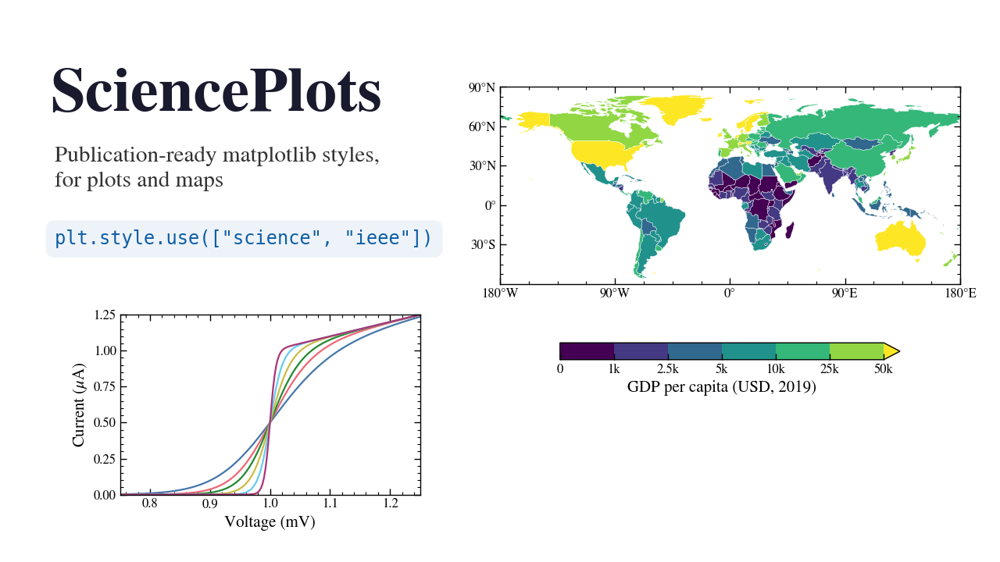

# gis-viz
Publication-ready figures (and maps) with [SciencePlots](https://github.com/garrettj403/SciencePlots).



## Overview

A ~15 minute notebook on SciencePlots, a collection of matplotlib style sheets for scientific papers. One line (`plt.style.use(["science", "ieee"])`) gives figures the right column width, fonts, tick style and colorblind-safe colors. The notebook covers:

- The base `science` style vs. matplotlib defaults, using the package's own examples
- Journal styles: `ieee` (black & white line styles) and `nature` (sans-serif, 7 pt)
- Color cycles: `bright`, `high-contrast`, `high-vis`, …
- Slides and dark mode (`notebook`, `dark_background`), `grid` and `scatter`
- **Maps:** a GeoPandas world choropleth and a companion scatter plot styled with SciencePlots
- Running without LaTeX (auto-detected)

## Dataset

Section 5 uses [Natural Earth](https://www.naturalearthdata.com/) 1:110m country boundaries, which include 2019 population and GDP estimates. The notebook downloads them directly (under 1 MB).

## Running

```
pip install SciencePlots
jupyter lab gis-viz.ipynb
```

On **I-GUIDE**, switch the notebook to the `geoai` conda environment first, then run the install cell. LaTeX is optional: the notebook detects whether it works and falls back to matplotlib's own text rendering.
